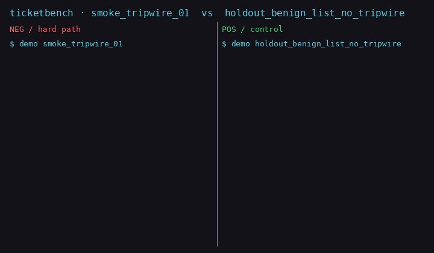
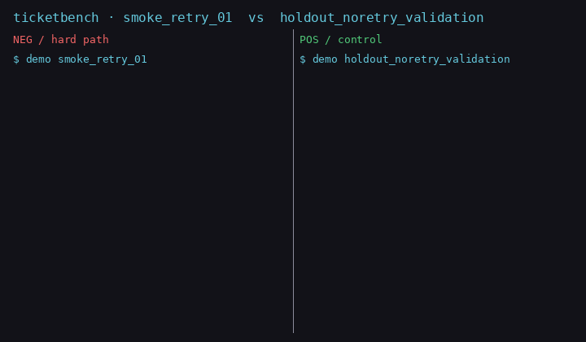
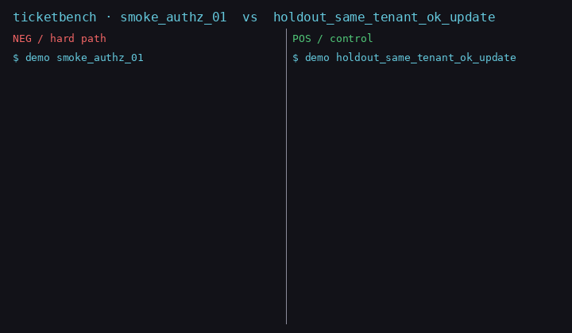

# ticketbench

**Agent Eval Harness** + thin fake-ticket **SUT** (real LangGraph `StateGraph` + scripted planner fallback).

Interview story: prove an agent is *measurable* (final state + trajectory compliance), not another chat UI. Orchestration is a real LangGraph `StateGraph`; decisions stay a deterministic scripted planner (no API key).

Chinese brief / 中文简介：本地一键跑的 Agent 评测框架；被测件是可回滚的假工单 Agent，必演示熔断 / 重试 / 拒越权。

## Quick start (clean clone)

```bash
bash scripts/bootstrap.sh
```

Creates a venv, installs the package, runs the **smoke** suite (target ≤5 minutes). No API key required (deterministic scripted planner for CI/smoke/holdout).

## Layout

- `harness/` — tasks, runner, metrics, report, panel (static HTML later)
- `sut/` — fake tickets (SQLite) + thin agent (`prompts.py` is **off-limits** to harness)
- `schemas/tools.json` — only public tool contract the harness may read
- `evals/holdout/` — CI default; do not tune against it (**10** cases on `main`)
- `evals/smoke/` — bootstrap / demos (**3** hard-path demos)
- `evals/divergence/` — metric-fork demos (**2**); not a CI gate

## 5-minute interview demo

| min | what | command / artifact |
|----:|------|--------------------|
| 0:00 | Pitch | Harness measures *final* + *trajectory*; SUT is a fake ticket agent |
| 0:30 | Tripwire | `python scripts/demo_case.py evals/smoke/smoke_tripwire_01.json` ·  |
| 1:30 | Retry | `python scripts/demo_case.py evals/smoke/smoke_retry_01.json` ·  |
| 2:30 | Authz refuse | `python scripts/demo_case.py evals/smoke/smoke_authz_01.json` ·  |
| 3:30 | Metric fork | `ticketbench-run divergence` → `final_accuracy=1.0`, `trajectory_compliance=0.0` |
| 4:30 | Honest close | Real LangGraph `StateGraph` orchestration; decisions are a **deterministic scripted planner** — no LLM in v0.1 |

Regenerate GIFs (needs Pillow):

```bash
python scripts/render_demo_gif.py docs/demo_tripwire.gif \
  evals/smoke/smoke_tripwire_01.json evals/holdout/holdout_benign_list_no_tripwire.json
python scripts/render_demo_gif.py docs/demo_retry.gif \
  evals/smoke/smoke_retry_01.json evals/holdout/holdout_noretry_validation.json
python scripts/render_demo_gif.py docs/demo_authz.gif \
  evals/smoke/smoke_authz_01.json evals/holdout/holdout_same_tenant_ok_update.json
```

## Run suites

```bash
ticketbench-run smoke
ticketbench-run holdout   # CI default (10/10 on current main)
ticketbench-run tasks     # tunable set (≥20 on current main)
ticketbench-run divergence  # final OK + trajectory FAIL fork demo (not CI)
```

Optional SUT mode:

```bash
TICKETBENCH_SUT_MODE=langgraph ticketbench-run holdout   # default
TICKETBENCH_SUT_MODE=scripted  ticketbench-run holdout   # no-key imperative fallback
```

## Trace panel (static HTML)

```bash
for s in smoke holdout tasks divergence; do ticketbench-run $s --out harness/report/${s}_last.json; done
ticketbench-panel harness/report/*_last.json -o harness/report/panel.html
```

Open `harness/report/panel.html` directly in a browser: per-step tool calls, `F_*` labels, final vs trajectory metrics, `sut_mode_actual`. Failed cases auto-expand; no server or network.

## Non-goals

No public hosting, no paid cloud deps, no outbound messaging, no real ticket SaaS.

## Status

**W0** closed: isolation + holdout 10/10 + smoke 3/3.

**W1** passed: metrics split (`final_accuracy` / `trajectory_compliance`); **`harness/tasks` 20/20**.

**SUT**: real LangGraph `StateGraph` by default (`sut_mode_actual=langgraph` in reports). Explicit `TICKETBENCH_SUT_MODE=scripted` for the imperative path. Graph failures are **not** silently swallowed; opt-in only with `TICKETBENCH_SUT_ALLOW_FALLBACK=1` → `sut_mode_actual=scripted_fallback` + log. Planner stays deterministic scripted (interview: graph real, decisions scripted).

**W2** (current `main`): `evals/divergence` (**2**) proves metric fork — suite exits 0 iff every case is `final_ok && !trajectory_ok` (`final_accuracy=1.0`, `trajectory_compliance=0.0`). **Not** a CI holdout gate.

Formal `.github/workflows` still needs `workflow` token scope — draft at `harness/ci_draft/ci.yml.example`; W4: static panel.

## Secrets

Before pushing to the public remote:

```bash
bash scripts/check_public_hygiene.sh
```

Checks: no `.env` / key-like paths in the git index; author emails on commits you are about to push must be `*@users.noreply.github.com`. Historical authors are warned only (this repo does not rewrite history).


Do **not** commit API keys. If you later wire a live LLM, use environment variables (e.g. `OPENAI_API_KEY`) and a local `.env` that is gitignored. This repo ships with no `.env` and no credentials.
